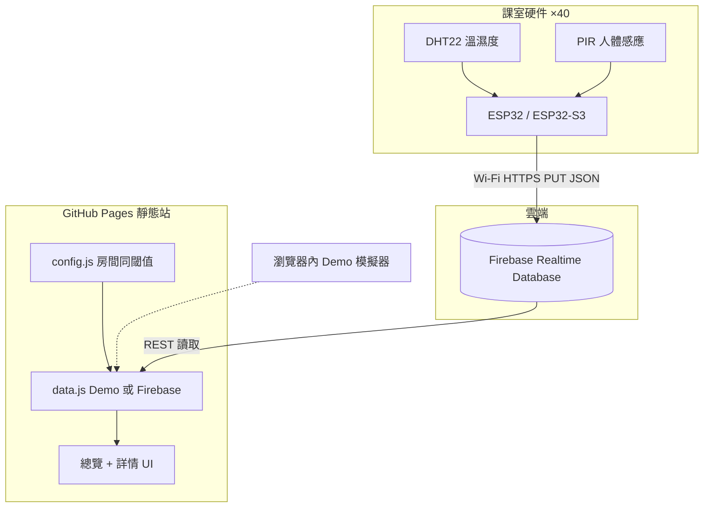

# 學校節能計劃 — 課室即時能源監察

**世界龍岡學校劉皇發中學**（Lung Kong World Federation School Limited Lau Wong Fat Secondary School）  
項目聯絡：IT Coordinator / ICT 老師

用 **ESP32 + 溫濕度 + 人體感應（PIR）** 監察大約 **40 間課室**，數據經 Wi-Fi 上雲，再喺 **GitHub Pages** 靜態網站以廣東話介面即時顯示狀態，幫學校發現「無人開冷氣」「過熱」「感測器離線」等情況，推動節能。

---

## 網站同倉庫

| 項目 | 連結 |
|------|------|
| GitHub 倉庫 | https://github.com/tlc-cmyk/lwfss-classroom-energy |
| GitHub Pages | https://tlc-cmyk.github.io/lwfss-classroom-energy/ |

未裝硬件之前，網站預設係 **示範模式（Demo）**，會自動模擬 40 間課室「活嚟」嘅數據，方便示範同教學。

---

## 功能一覽

- **總覽頁**：40 張課室卡，顏色狀態一目了然；可搜尋、篩選樓層／狀態
- **詳情頁**：溫度、濕度、有冇人、最後更新時間、歷史圖表（Chart.js）、節能建議
- **狀態顏色**
  - 🟢 **綠色**：正常（有人且溫濕度合理）
  - 🟠 **橙色**：溫度偏高（例如 >28°C）、濕度異常、或者有人但過凍（可能冷氣過凍浪費）
  - 🔴 **紅色**：過熱（例如 >30°C）或感測器離線
  - ⚪ **灰色**：無人／閒置
- **離線偵測**：超過 N 分鐘（預設 5 分鐘）未更新 → 顯示離線
- **Demo / Firebase** 一鍵切換（改 `docs/js/config.js`）

---

## 系統架構



**點解用呢個架構？**  
GitHub Pages 只可以放靜態網頁，唔可以跑伺服器。所以裝置寫入 **Firebase Realtime Database**，網站用 REST 讀；開發／示範期用 **純前端模擬器**，唔使開帳號都可以展示。

### JSON 資料格式

```json
{
  "roomId": "R01",
  "name": "1A",
  "temp": 26.5,
  "humidity": 68,
  "occupied": true,
  "updatedAt": 1728630000000
}
```

Firebase 路徑建議：`/rooms/R01`、`/rooms/R02` …（同韌體 `FIREBASE_PATH`、網站 `roomsPath` 一致）。

---

## 倉庫目錄

```
lwfss-classroom-energy/
├── README.md                 ← 你而家睇緊呢份（廣東話）
├── LICENSE                   ← MIT
├── .gitignore
├── docs/                     ← GitHub Pages 網站根目錄
│   ├── index.html            ← 課室總覽
│   ├── room.html             ← 單課室詳情
│   ├── css/styles.css
│   └── js/
│       ├── config.js         ← 校名、房間、閾值、Firebase、demo/firebase 切換
│       ├── data.js           ← 資料層（Demo 模擬 + Firebase 讀取）
│       ├── overview.js
│       └── room.js
└── firmware/
    ├── WIRING.md             ← 接線、安裝、燒錄
    └── classroom_energy/
        ├── classroom_energy.ino
        └── config.h.example  ← 複製成 config.h 再填密碼
```

---

## 硬件清單同預算粗估（40 套）

| 項目 | 單價粗估（HKD） | ×40 |
|------|-----------------|-----|
| ESP32-S3 / ESP32 DevKit | $25–45 | $1,000–1,800 |
| DHT22 模組 | $15–25 | $600–1,000 |
| PIR 模組 | $8–15 | $320–600 |
| 杜邦線／盒子／螺絲端子 | $15–30 | $600–1,200 |
| 5V USB 電源適配器 | $20–35 | $800–1,400 |
| **合計（粗估）** | | **約 $3,300–6,000** |

實際以當時供應商報價為準；可先做 **2–4 間試點**，再全校鋪開。  
雲端方面：Firebase Spark（免費額度）通常夠學校示範同中小規模讀寫；GitHub Pages 免費。

詳細接線請睇 [`firmware/WIRING.md`](firmware/WIRING.md)。

---

## 快速開始（只睇網站 Demo）

1. 打開 Pages：https://tlc-cmyk.github.io/lwfss-classroom-energy/
2. 或者本機預覽：

```bash
cd docs
python3 -m http.server 8080
# 瀏覽器開 http://localhost:8080/
```

3. 總覽會見到 40 間課室；撳入去睇詳情同圖表。數據大約每 5 秒更新一次。

---

## 點樣改房間名稱／校名／閾值

編輯 [`docs/js/config.js`](docs/js/config.js)：

- `schoolName`、`projectName`
- `rooms[]`：`roomId`（要同 ESP32 一致）、`name`（例如 `1A`）、`floor`、`wing`
- `thresholds.tempWarn` / `tempHot` / `tempCool`、濕度上下限
- `offlineMinutes`：幾耐無更新當離線
- `dataMode`：`'demo'` 或 `'firebase'`
- `firebase.databaseURL`：你嘅 Realtime Database URL

改完 push 去 `main`，Pages 會自動更新（可能要等一兩分鐘）。

---

## Firebase 設定（接硬件用）

1. 去 [Firebase Console](https://console.firebase.google.com/) 開新專案。
2. 建立 **Realtime Database**（建議 `asia-southeast1`）。
3. 規則示例（**示範用**；正式環境請收緊）：

```json
{
  "rules": {
    "rooms": {
      ".read": true,
      "$roomId": {
        ".write": true
      }
    }
  }
}
```

> 正式上線建議：公開唯讀；寫入要用 Firebase Auth／裝置 token，唔好長期開放 `.write: true`。

4. 複製 Database URL（形如 `https://xxx-default-rtdb.asia-southeast1.firebasedatabase.app`）。
5. 喺 `docs/js/config.js`：
   - `dataMode: 'firebase'`
   - `firebase.databaseURL: 'https://....'`
6. ESP32 `config.h` 填 `FIREBASE_HOST`（**唔使**加 `https://`）、`FIREBASE_AUTH`（database secret 或規則允許嘅 token）、`ROOM_ID`。

網站會 GET：

`{databaseURL}/rooms.json`

裝置會 PUT：

`https://{FIREBASE_HOST}/rooms/{ROOM_ID}.json?auth=...`

---

## ESP32 燒錄摘要

1. 複製設定：

```bash
cd firmware/classroom_energy
cp config.h.example config.h
# 用編輯器填 WIFI_SSID、WIFI_PASSWORD、FIREBASE_*、ROOM_ID、腳位
```

2. Arduino IDE 安裝 esp32 板同函式庫（DHT、Adafruit Unified Sensor、ArduinoJson）。
3. 選板 → 上載 → Serial Monitor 115200 睇「Firebase PUT HTTP 200」。
4. 每一間課室燒錄前改唔同 `ROOM_ID` / `ROOM_NAME`。

完整接線同注意事項：[`firmware/WIRING.md`](firmware/WIRING.md)。

---

## 部署 GitHub Pages

本倉庫用 **`main` 分支嘅 `/docs` 資料夾** 作為網站根目錄。

若要重新設定：

1. GitHub 倉庫 → **Settings** → **Pages**
2. Source：Deploy from a branch
3. Branch：`main`，Folder：`/docs` → Save

用 `gh` CLI（已認證時）：

```bash
gh api repos/tlc-cmyk/lwfss-classroom-energy/pages \
  -X POST \
  -f build_type=legacy \
  -f source[branch]=main \
  -f source[path]=/docs
```

或更新現有設定：

```bash
gh api repos/tlc-cmyk/lwfss-classroom-energy/pages \
  -X PUT \
  -f build_type=legacy \
  -f source[branch]=main \
  -f source[path]=/docs
```

---

## 節能解讀（俾老師／總務參考）

| 現象 | 可能意思 | 建議動作 |
|------|----------|----------|
| 無人 + 溫度好低（例如 <22°C） | 懷疑冷氣／風扇未關 | 派人確認，養成「走人關機」 |
| 有人 + 溫度過低 | 冷氣開得過凍 | 調高 1–2°C，一樣舒服又慳電 |
| 有人 + 過熱（>30°C） | 冷氣故障、門窗長開、人多負荷大 | 檢查設備同通風 |
| 濕度好高 | 通風唔夠、雨天、人多 | 適度抽濕／開窗對流（視天氣） |
| 長時間離線 | Wi-Fi、電源、感測器鬆脫 | IT 巡查該課室裝置 |

系統**唔會直接量度電錶度數**；佢用環境同佔用狀態做「異常提示」，配合校務巡查同節約運動最有效。

---

## 替代上傳方式（進階，可選）

如果唔想用 Firebase，可以：

- 自建 **Cloudflare Worker** 接收 ESP32 POST，再寫入 KV／D1，網站改讀 Worker API
- 或者用其他 IoT 平台（Blynk、ThingsBoard 等）

本倉庫主路徑係 **Firebase + GitHub Pages Demo**，夠學校 IT 老師快速落地。

---

## 授權

MIT License — 歡迎其他學校 fork 改名使用。請保留出處同按授權條款。

---

## 貢獻同維護

- 改 UI／房間：PR 或者直接改 `docs/`
- 改韌體：`firmware/classroom_energy/`
- 問題回報：開 GitHub Issue

**世界龍岡學校劉皇發中學 · 學校節能計劃**
