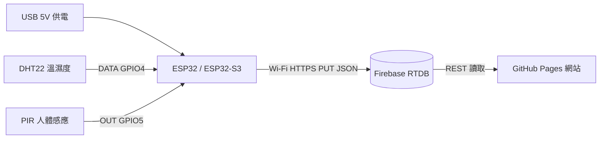

# 接線說明（ESP32 / ESP32-S3 + DHT22 + PIR）

## 零件清單（每一間課室一套）

| 零件 | 數量 | 備註 |
|------|------|------|
| ESP32-S3 DevKit 或 ESP32 DevKit | 1 | 有 Wi-Fi；S3 較新 |
| DHT22（AM2302）溫濕度感測器 | 1 | 亦可用 DHT11（準確度較低） |
| PIR 人體感應模組（HC-SR501 或類似） | 1 | 調好靈敏度／延遲旋鈕 |
| 杜邦線、麵包板或焊接板 | 若干 | 長期安裝建議焊接／螺絲端子 |
| 5V USB 供電（牆插或 PoE→USB） | 1 | 課室長期開機 |

## 腳位（預設，可喺 `config.h` 改）

| 訊號 | ESP32 / S3 GPIO | 感測器腳 |
|------|-----------------|----------|
| DHT22 DATA | GPIO 4 | DATA |
| DHT22 VCC | 3V3 | VCC（DHT22 亦可 5V，視模組） |
| DHT22 GND | GND | GND |
| PIR OUT | GPIO 5 | OUT |
| PIR VCC | 5V（或 3V3，視模組） | VCC |
| PIR GND | GND | GND |

> 部分 DHT 模組已內建上拉電阻；若無，DATA 同 3V3 之間加 **4.7kΩ～10kΩ** 上拉。

## ASCII 接線圖

```
                    +3V3 / 5V
                         |
          +--------------+--------------+
          |                             |
     +----+----+                   +----+----+
     |  DHT22  |                   |   PIR   |
     | VCC DATA GND                | VCC OUT GND
     +----+-+--+                   +----+-+--+
          | |                           | |
          | |    ESP32-S3 / ESP32       | |
          | |  +-------------------+    | |
          | +--| GPIO4 (DHT)       |    | |
          |    | GPIO5 (PIR)  <----+----+ |
          +----| 3V3 / 5V          |      |
               | GND  <------------+------+
               | USB 5V 供電       |
               +-------------------+
```

## Mermaid



## 安裝位置建議

1. **DHT22**：唔好直接吹冷氣出風口；放喺課室中央偏高、避免日曬。
2. **PIR**：對住學生座位／門口活動範圍；避開窗外強光同冷氣擺動簾。
3. **ESP32**：靠近課室 Wi-Fi 覆蓋較好嘅位置；天線唔好金屬遮擋。
4. 用膠盒／3D 打印盒保護，預留感測開孔。

## 功耗同供電

- 持續 Wi-Fi 上傳：大約數十至一百多 mA（視模組）。
- 建議用穩定 **5V 1A** USB 牆插；唔建議淨靠電腦 USB 長期供電。
- 若要電池供電，需要大幅改做 deep sleep（本 sketch 以插電長開為主）。

## 燒錄步驟（Arduino IDE）

1. 安裝 [Arduino IDE 2.x](https://www.arduino.cc/en/software)。
2. 偏好設定 → 額外開發板管理員網址加入 Espressif：
   `https://espressif.github.io/arduino-esp32/package_esp32_index.json`
3. 開發板管理員安裝 **esp32** by Espressif。
4. 函式庫管理員安裝：`DHT sensor library`、`Adafruit Unified Sensor`、`ArduinoJson`。
5. `cp config.h.example config.h`，填 Wi-Fi、Firebase、ROOM_ID。
6. 選對板型同埠，上載。
7. 打開 Serial Monitor（115200），確認 Wi-Fi 同 Firebase HTTP 200。

## PlatformIO（可選）

可喺 `firmware/classroom_energy` 旁自行加 `platformio.ini`，例如：

```ini
[env:esp32-s3]
platform = espressif32
board = esp32-s3-devkitc-1
framework = arduino
monitor_speed = 115200
lib_deps =
  adafruit/DHT sensor library
  adafruit/Adafruit Unified Sensor
  bblanchon/ArduinoJson
```
